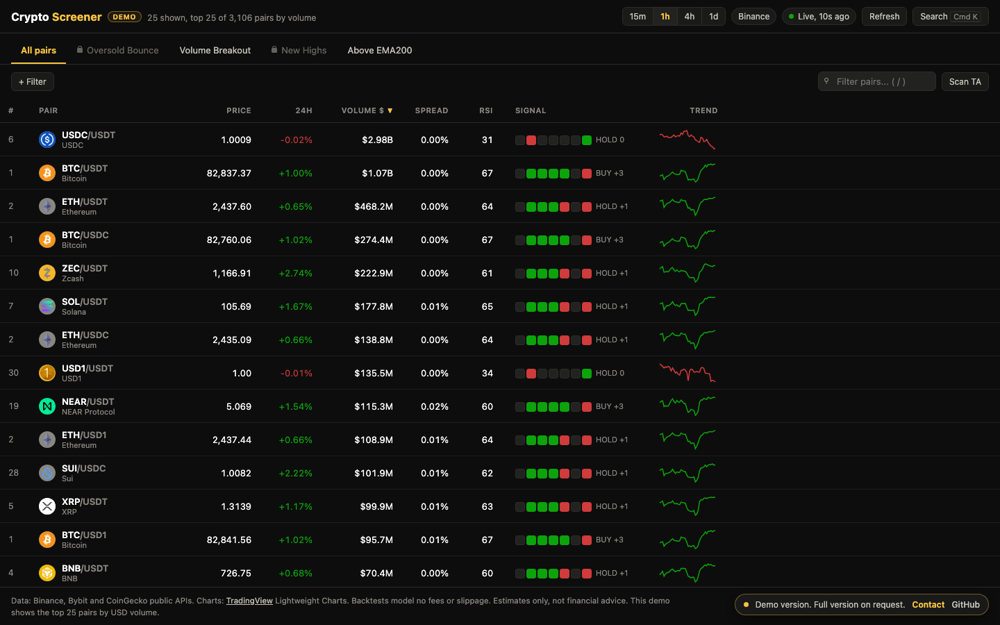

# Crypto Screener

A full-market crypto screener that ranks every Binance spot pair live and runs the technical analysis right in the browser.

**Live demo: https://artinbahmani.artin-bahmani0.workers.dev/crypto-screener/**

The demo covers the top 25 pairs by volume and two preset screens. The full version screens the whole market of 3,000+ pairs.

## What it does

- **Whole market in one view.** Every Binance spot pair loads in a single request. Volumes in other quote currencies (TRY, BRL, BTC and more) are converted to US dollars, so the rankings stay comparable.
- **Preset screens and composable filters.** One-click screens such as Oversold Bounce, Volume Breakout, New Highs and Above EMA200, plus filter chips that chain conditions on volume, change, spread, RSI and EMA distance.
- **Indicator signals at a glance.** RSI, MACD, EMA 20/50/200, Bollinger %B and Stochastic for each pair, summed into a seven-part BUY / HOLD / SELL strip with a net score and a sparkline.
- **Pair deep dive.** A candlestick chart, indicator tiles and an SMA crossover parameter sweep shown as a Sharpe ratio heatmap. Click any cell to see its equity curve against buy and hold. Lone "overfit islands" are flagged.
- **Command palette.** Type something like `sol 4h breakout` to open a pair, change the interval and apply a screen in one step.
- **Built to stay up.** A live/stale freshness badge, automatic fallback from Binance to its public mirror and then to Bybit, and polling that stays well inside public rate limits.

## How it works

The app is a static single page with no server and no API keys. A single call fetches tickers for the whole market. A small baked symbol map splits each pair into base and quote assets without downloading the large exchange metadata. Indicators are computed lazily, only for the rows you are looking at, and cached per interval in the browser. A virtualized table keeps sorting and scrolling smooth across thousands of rows. Coin names, logos and ranks come from CoinGecko and are added as extra decoration. If CoinGecko is unavailable, the table shows letter badges instead.

Backtests show gross returns, without fees, slippage or funding. Every number is an estimate for exploration and is not financial advice.

## Stack

- Vanilla JavaScript, HTML and CSS (no framework)
- TradingView Lightweight Charts for candlesticks and equity curves
- Canvas for the parameter-sweep heatmap, inline SVG for sparklines
- Data: Binance public REST API (with the `data-api.binance.vision` mirror), Bybit public API as a fallback, CoinGecko for coin metadata

## Get the full version

Source code is private. To use it in your business or get the full version, contact me: artin.bahmani0@gmail.com

All rights reserved.
